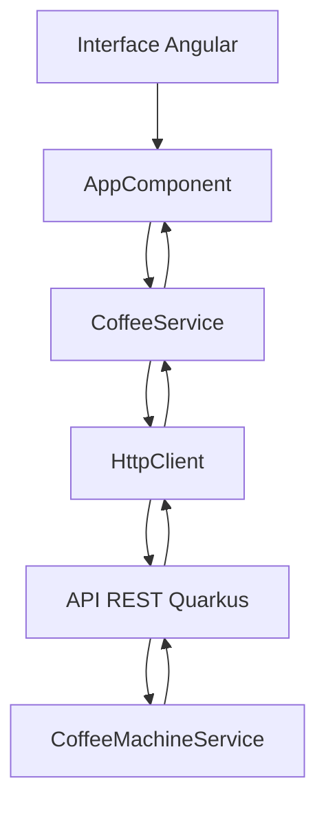

# Coffee Machine 2.0 — Frontend Angular


Interface web do **Coffee Machine 2.0**, desenvolvida com Angular e TypeScript e integrada a uma API REST em Java com Quarkus.

O projeto simula uma máquina de café, permitindo comprar bebidas, abastecer ingredientes, consultar o estoque e retirar o dinheiro do caixa.

Este diretório contém o frontend. A documentação do sistema completo está no [README principal](../README.md).

## Funcionalidades

- **Buy:** compra de Espresso, Latte e Cappuccino.
- **Fill:** reabastecimento de água, leite, grãos de café e copos.
- **Remaining:** visualização do estoque atualizado.
- **Take:** retirada do dinheiro acumulado.
- **Log de operações:** histórico temporário das mensagens retornadas pela API.
- **Interface adaptável:** layout que se reorganiza em janelas mais estreitas.

O estado da máquina é gerenciado pelo backend. O frontend apresenta e atualiza os valores recebidos por HTTP.

## Tecnologias utilizadas

| Tecnologia | Finalidade |
| --- | --- |
| Angular 22 | Construção da interface |
| TypeScript | Lógica e tipagem |
| HTML e CSS | Estrutura e aparência |
| Angular Forms | Formulário de abastecimento |
| HttpClient | Comunicação com a API REST |
| RxJS | Tratamento assíncrono de requisições |
| Angular CLI | Desenvolvimento e build |

A aplicação utiliza um componente standalone inicializado com `bootstrapApplication()`.

## Como executar

### Pré-requisitos

- Node.js e npm compatíveis com Angular 22.
- JDK 21 ou superior.
- Maven.
- Git, para clonar o repositório.

O backend precisa estar em execução para que o frontend funcione corretamente.

### 1. Clonar o repositório

```bash
git clone https://github.com/fhenrique77/Coffee_Machine_2.0.git
cd Coffee_Machine_2.0
```

### 2. Iniciar o backend Quarkus

Em um primeiro terminal:

```bash
cd coffee-backend
mvn quarkus:dev
```

A API ficará disponível em:

`http://localhost:8080`

### 3. Iniciar o frontend Angular

Em um segundo terminal, a partir da raiz do repositório:

```bash
cd coffee-frontend
npm ci
npm start
```

Acesse:

`http://localhost:4200`

O servidor de desenvolvimento acompanha alterações nos arquivos e atualiza a aplicação durante o desenvolvimento.

## Como utilizar

### Comprar bebidas — Buy

Selecione uma das bebidas disponíveis:

| Bebida | Água | Leite | Grãos | Preço |
| --- | ---: | ---: | ---: | ---: |
| Espresso | 250 ml | 0 ml | 16 g | $4 |
| Latte | 350 ml | 75 ml | 20 g | $7 |
| Cappuccino | 200 ml | 100 ml | 12 g | $6 |

Cada bebida utiliza também um copo.

O backend verifica a disponibilidade dos ingredientes antes de efetuar a compra. Se faltar algum recurso, informa o problema sem concluir a operação.

### Reabastecer — Fill

Informe as quantidades que deseja adicionar:

- Água (ml).
- Leite (ml).
- Grãos de café (g).
- Copos.

O formulário utiliza `ngModel` para vincular os campos ao objeto enviado ao backend.

### Consultar estoque — Remaining

O painel lateral apresenta:

- Água disponível.
- Leite disponível.
- Quantidade de grãos.
- Copos restantes.
- Dinheiro em caixa.

A consulta inicial ocorre quando o componente é carregado. Depois de cada operação concluída, o estoque é atualizado com a resposta da API.

### Retirar dinheiro — Take

A opção **Take** solicita ao backend a retirada do dinheiro acumulado.

Após a operação, o valor do caixa é zerado no backend e a interface recebe o estado atualizado.

## Integração com a API REST

O serviço Angular está implementado em:

`src/app/coffee.service.ts`

A URL base configurada é:

```text
http://localhost:8080/api/machine
```

### Endpoints

| Método | Endpoint | Operação |
| --- | --- | --- |
| GET | `/remaining` | Consultar estoque |
| POST | `/buy/{type}` | Comprar bebida |
| POST | `/fill` | Adicionar recursos |
| POST | `/take` | Retirar dinheiro |

### Exemplo de abastecimento

```json
{
  "water": 100,
  "milk": 50,
  "coffeeBeans": 20,
  "cups": 2
}
```

### Exemplo de estoque inicial

```json
{
  "water": 400,
  "milk": 540,
  "coffeeBeans": 120,
  "cups": 9,
  "money": 550
}
```

As operações de compra, abastecimento e retirada retornam um objeto contendo:

- `message`: mensagem do backend.
- `stock`: estado atualizado da máquina.

O frontend usa esses dados para atualizar o painel e registrar a operação no log.

## Arquitetura



### Responsabilidades

**AppComponent**

- Mantém os dados apresentados na interface.
- Define as receitas disponíveis.
- Controla o formulário de abastecimento.
- Executa ações de compra e retirada.
- Atualiza o histórico de mensagens.

**CoffeeService**

- Centraliza as chamadas HTTP.
- Define as interfaces TypeScript `Stock` e `Result`.
- Encapsula os endpoints do backend.

**AppConfig**

- Configura o `HttpClient` com `provideHttpClient()`.

## Estrutura do frontend

```text
coffee-frontend/
├── public/
├── src/
│   ├── app/
│   │   ├── app.component.ts
│   │   ├── app.component.html
│   │   ├── app.component.css
│   │   ├── app.config.ts
│   │   └── coffee.service.ts
│   ├── index.html
│   ├── main.ts
│   └── styles.css
├── angular.json
├── package.json
├── package-lock.json
└── README.md
```

## Comandos disponíveis

Execute os comandos dentro de `coffee-frontend/`.

| Comando | Descrição |
| --- | --- |
| `npm start` | Inicia o servidor Angular |
| `npm run build` | Gera o build de produção |
| `npm run watch` | Recompila ao detectar alterações |
| `npm test` | Executa o comando de testes do Angular |
| `npm run ng -- --help` | Exibe a ajuda da Angular CLI |

### Build de produção

```bash
npm run build
```

Os artefatos gerados são armazenados na pasta `dist/`, conforme a configuração do Angular CLI.

### Testes

```bash
npm test
```

O projeto possui o comando de testes e as dependências necessárias, mas ainda não contém testes específicos do componente frontend versionados.

## Configuração de CORS

O backend Quarkus permite requisições provenientes de:

`http://localhost:4200`

Caso o frontend seja executado em outra origem, pode ser necessário alterar a configuração CORS do backend em:

`coffee-backend/src/main/resources/application.properties`

A URL utilizada pelo frontend está atualmente definida diretamente em `coffee.service.ts`.

## Limitações conhecidas

- A URL da API está fixa no código.
- O backend mantém os dados em memória, sem persistência em banco de dados.
- Não existe autenticação.
- O frontend ainda não possui tratamento explícito de erros para todas as operações HTTP.
- O log de mensagens é temporário e desaparece ao recarregar a página.
- Não há suíte de testes específica do frontend implementada.
- As regras de validação de abastecimento precisam ser garantidas também no servidor.


## Autor

**Felipe Henrique Oliveira Sousa**

Estudante de Engenharia de Software na Universidade de Brasília (UnB).

GitHub: [@fhenrique77](https://github.com/fhenrique77)

Projeto completo: [Coffee Machine 2.0](../README.md).
